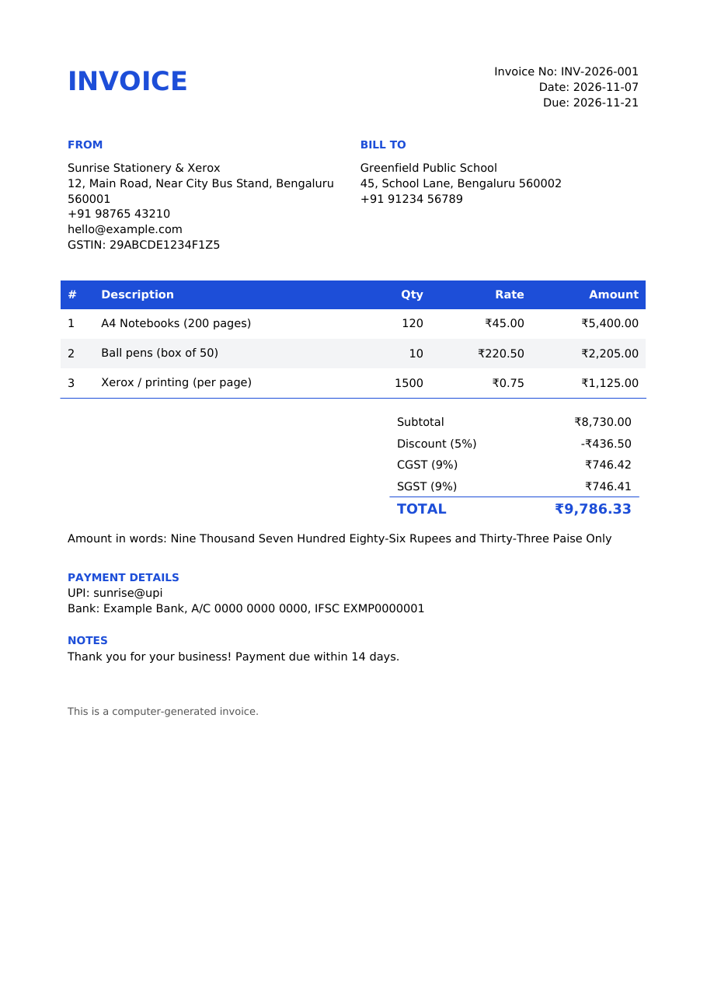

<div align="center">

# Invoice Generator

**Turn a simple JSON file into a clean, print-ready PDF invoice with GST, discounts and Indian number formatting.**


</div>

---

## Overview

A Python tool that turns a simple JSON file into a professional **PDF invoice**. Built for small shops and freelancers who need proper bills without paying for billing software.

## Problem Statement

Many small businesses still write bills by hand or in Word, which leads to calculation mistakes, inconsistent layouts and missing GST details. Billing software costs money and takes time to learn. This tool produces an accurate, consistent invoice from a few lines of data.

## Features

- **Professional PDF layout**: seller and customer details, itemised table, totals, payment details and notes
- **GST support**: enter one GST percentage and it is split into CGST and SGST automatically
- **Discounts**: optional percentage discount applied before tax
- **Indian formatting**: ₹ symbol, lakh/crore digit grouping (`12,34,567.50`) and the total in words
- **Accurate money maths**: uses Python's `Decimal`, so there are no floating-point rounding errors
- **Input validation**: clear error messages for missing fields, zero quantities and invalid numbers
- **Brand colour**: change the accent colour per client
- **Tested**: 11 automated tests with pytest

## Screenshots

Page one of [`sample_invoice.pdf`](sample_invoice.pdf), generated from `sample_invoice.json`:

<p align="center"></p>

## Tech Stack

- **Language:** Python 3
- **PDF generation:** ReportLab (Platypus tables and paragraphs)
- **Money calculations:** `decimal.Decimal`
- **Testing:** pytest

## Project Structure

```text
invoice-generator-pdf/
├── invoice.py            # validation, calculations, PDF layout and command-line interface
├── test_invoice.py       # 11 automated tests
├── sample_invoice.json   # example input to copy and edit
├── sample_invoice.pdf    # PDF produced from the example
├── screenshots/          # preview image used in this README
├── requirements.txt
└── .gitignore
```

## Installation and Setup

```bash
git clone https://github.com/MohammedShareef3527/invoice-generator-pdf.git
cd invoice-generator-pdf
pip install -r requirements.txt
python invoice.py sample_invoice.json
```

This creates a PDF named after the invoice number. To choose the file name:

```bash
python invoice.py sample_invoice.json -o my_invoice.pdf
```

## Configuration

Copy `sample_invoice.json` and edit it:

| Field | Required | Notes |
|---|---|---|
| `seller` | yes | `name` required; `address`, `phone`, `email`, `gstin` optional |
| `customer` | yes | `name` required; `address`, `phone`, `email`, `gstin` optional |
| `items` | yes | list of `description`, `quantity`, `rate` |
| `invoice_number`, `date`, `due_date` | no | defaults to an auto number and today's date |
| `discount_percent` | no | 0 to 100 |
| `gst_percent` | no | for example 18 |
| `payment_details`, `notes` | no | free text; use `\n` for new lines |
| `accent_color` | no | hex colour, for example `#1d4ed8` |

The sample file uses made-up business details. Keep real customer and bank details out of files you commit.

## How It Works

1. `validate()` checks the JSON has everything needed
2. `calculate()` works out line totals, discount, GST and the grand total using `Decimal`
3. `generate_invoice()` lays out the PDF with ReportLab's Platypus (tables and paragraphs)
4. `amount_in_words()` converts the total using the Indian system (thousand, lakh, crore)
5. The tool looks for a font that contains the ₹ symbol (Segoe UI, Arial or DejaVu) and falls back to `Rs.` if none is found

## Run the Tests

```bash
pytest
```

## Future Improvements

These are planned ideas, not current features:

- A simple GUI or web form for entering invoice data
- IGST support for inter-state sales
- Company logo on the invoice
- Auto-incrementing invoice numbers saved between runs

## Learning Outcomes

- Generating documents programmatically with ReportLab
- Exact financial arithmetic with `Decimal` and correct rounding
- Implementing Indian GST rules (CGST and SGST split) and the lakh/crore number system
- Validating structured JSON input with helpful error messages
- Writing unit tests for calculations and file output

## Author

**Mohammed Shamsul Qhadri Shareef**
GitHub: [@MohammedShareef3527](https://github.com/MohammedShareef3527)
